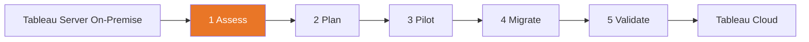
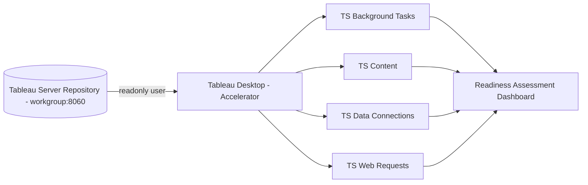
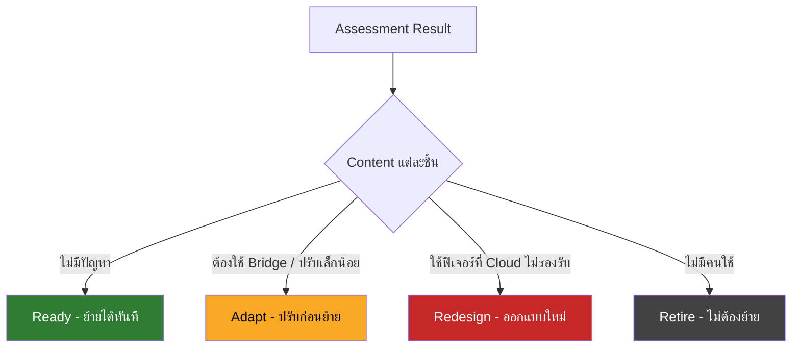

# Tableau Cloud Migration Technical Readiness Assessment

**คู่มือประเมินความพร้อมก่อนย้ายจาก Tableau Server (On-Premise) ไป Tableau Cloud**


---

## 📥 ดาวน์โหลด Accelerator ฟรีจาก Tableau Exchange

[](https://exchange.tableau.com/products/921)

> [!TIP]
> **กดปุ่มด้านบนเพื่อดาวน์โหลด Workbook** แล้วเปิดด้วย Tableau Desktop ได้ทันที
> 🔗 ลิงก์ตรง: **https://exchange.tableau.com/products/921**

| 📦 สิ่งที่ได้ | ⏱️ เวลาประเมิน | 🖥️ รองรับ | 💰 ราคา |
|:-:|:-:|:-:|:-:|
| Workbook สำเร็จรูป (.twbx) | ไม่กี่นาที | Tableau Server 2021.3+ | ฟรี |

**3 ขั้นสั้น ๆ:** ⬇️ [ดาวน์โหลด](https://exchange.tableau.com/products/921) → 🔓 [เปิดสิทธิ์ Repository](#-เปิดสิทธิ์เข้าถึง-tableau-server-repository) → 🚀 [ทำตามขั้นตอนใช้งาน](#5-ขั้นตอนการใช้งาน)

---

🧭 [ที่มาที่ไป](#1-ที่มาที่ไป) •
⚖️ [Server vs Cloud](#2-tableau-server-vs-tableau-cloud) •
🧰 [รู้จัก Accelerator](#3-รู้จัก-accelerator) •
✅ [สิ่งที่ต้องเตรียม](#4-สิ่งที่ต้องเตรียม) •
🛠️ [ขั้นตอนใช้งาน](#5-ขั้นตอนการใช้งาน) •
📊 [อ่านผลลัพธ์](#6-การอ่านผลลัพธ์) •
🚚 [Roadmap](#7-roadmap-การ-migrate) •
❓ [FAQ](#8-faq-และ-troubleshooting) •
🔗 [แหล่งอ้างอิง](#9-แหล่งอ้างอิง)

---

> [!NOTE]
> คู่มือนี้อธิบายการใช้งาน **Tableau Cloud Migration Technical Readiness Assessment** ซึ่งเป็น Accelerator ฟรีจาก Tableau บน [Tableau Exchange](https://exchange.tableau.com/products/921) พร้อมเล่าที่มาที่ไปของการย้ายระบบจาก Tableau Server แบบ On-Premise ไปยัง Tableau Cloud สำหรับ Tableau Administrator, ทีม IT และ Presales ที่ต้องประเมินความพร้อมให้ลูกค้า

---

## 1. ที่มาที่ไป

### 🧭 ทำไมต้องย้ายไป Tableau Cloud

องค์กรจำนวนมากเริ่มใช้ Tableau ด้วยการติดตั้ง **Tableau Server บนเครื่องของตัวเอง (On-Premise)** ซึ่งควบคุมได้ทุกอย่าง แต่ก็ต้องดูแลเองทุกอย่างเช่นกัน เมื่อระบบโตขึ้น ภาระเหล่านี้จะเพิ่มขึ้นตาม:

| 😩 ภาระของ Tableau Server On-Premise | ☁️ สิ่งที่ Tableau Cloud ช่วยได้ |
|---|---|
| ต้องจัดหา Hardware / VM, OS, Storage เอง | Tableau เป็นผู้ Host และดูแล Infrastructure ให้ (รันบน AWS) |
| ต้องวางแผน Upgrade เวอร์ชัน + Downtime | ใช้เวอร์ชันล่าสุดเสมอ, Major upgrade แบบ zero downtime |
| ต้องทำ Backup / DR / Patch Security เอง | Tableau ทำ Daily backup สำหรับ Disaster Recovery ของระบบ |
| ต้องมี Admin คอยดูแล TSM, Process, Performance tuning | Admin โฟกัสที่ Governance, Content และผู้ใช้แทน |
| License แบบ Core-based / Perpetual บางส่วน | Subscription แบบ Role-based (Creator / Explorer / Viewer) |
| ฟีเจอร์ใหม่มาช้า (ต้องรอ Upgrade) | ได้ฟีเจอร์ใหม่ก่อน เช่น Tableau Pulse, Tableau Agent |

> [!IMPORTANT]
> Tableau เองก็ **ไม่ได้แนะนำให้ลูกค้า Tableau Server ทุกรายย้ายไป Cloud** ควรศึกษาความแตกต่างและยืนยันแผนกับ Account Team ก่อนเสมอ — นี่คือเหตุผลที่ต้องมี **การประเมินความพร้อมทางเทคนิค (Technical Readiness Assessment)** ก่อนตัดสินใจ

### 🔄 ภาพรวมเส้นทาง Migration



| ขั้น | ความหมาย |
|---|---|
| 1 Assess | ประเมินความพร้อมด้วย Readiness Assessment |
| 2 Plan | วางแผนแก้ Use case ที่ไม่รองรับ |
| 3 Pilot | ทดลองย้ายบางส่วน |
| 4 Migrate | ย้าย Users และ Content |
| 5 Validate | ตรวจผลและ Cutover |

คู่มือนี้โฟกัสที่ **ขั้นที่ 1 — Assess** ซึ่งเป็นด่านแรกที่สำคัญที่สุด เพราะบอกได้ตั้งแต่ต้นว่า "อะไรย้ายได้ทันที" และ "อะไรต้องปรับก่อนย้าย"

---

## 2. Tableau Server vs Tableau Cloud

ก่อนใช้ Accelerator ควรเข้าใจจุดต่างหลัก เพราะผลประเมินจะชี้ไปที่เรื่องเหล่านี้

### 🔐 Security, Administration & Governance

| หัวข้อ | Tableau Cloud | Tableau Server |
|---|---|---|
| Hosting & Upgrade | Tableau ดูแล | ลูกค้าดูแลเอง |
| Site | ค่าเริ่มต้น Single site (เพิ่มได้ตาม Edition ผ่าน Tableau Cloud Manager) | กำหนดเองได้ |
| ข้อมูล Monitoring | **Admin Insights** (+ Activity Log สำหรับ Advanced Management / Enterprise ขึ้นไป) | ต่อ Repository (PostgreSQL) ได้โดยตรง |
| Compliance | ISO 27001/27017/27018, SOC 2/3, GDPR | ลูกค้ารับผิดชอบเอง |

### 🔌 Data Connectivity

| หัวข้อ | Tableau Cloud | Tableau Server |
|---|---|---|
| ไฟล์ (Excel, CSV ฯลฯ) | ✅ รองรับ (ไฟล์บน Cloud storage ต่อตรงได้) | ✅ |
| Database / Application | ✅ รองรับ แต่มีข้อจำกัดบาง Database | ✅ |
| ข้อมูล On-Premise / Private network | ต้องใช้ **Tableau Bridge** | ต่อตรงได้ |
| Custom connector (.taco / Connector SDK) | ❌ ไม่รองรับ | ✅ |
| Cube data source | ❌ ไม่รองรับ | ✅ |
| Kerberos กับ Database | ❌ ไม่รองรับ | ✅ |

### 👥 User Management & Licensing

| หัวข้อ | Tableau Cloud | Tableau Server |
|---|---|---|
| Licensing | Role-based subscription (ไม่รองรับ Core-based / Perpetual) | Role-based และ Core-based |
| SSO | ✅ SAML / OIDC (Okta, Azure AD/Entra ID ฯลฯ) | ✅ |
| Active Directory / LDAP / Kerberos | ❌ ไม่รองรับโดยตรง (ใช้ผ่าน IdP แทน) | ✅ |
| MFA | **บังคับใช้ทุกผู้ใช้** | ตั้งค่าเอง |
| Guest user | ❌ ไม่มี (ใช้ Connected Apps แทน) | ✅ |
| User provisioning อัตโนมัติ | SCIM ผ่าน IdP | AD / LDAP sync |

### 🧩 Extensibility & Customization

| หัวข้อ | Tableau Cloud | Tableau Server |
|---|---|---|
| REST API | ✅ ระดับ Site (แนะนำ Auth ด้วย PAT) | ✅ ระดับ Server |
| Web Data Connector | ต้อง Refresh ผ่าน Bridge | รองรับ list ระดับ Server |
| R / Python (Analytics Extensions) | ✅ (แต่ใช้กับ Data source ที่ผ่าน Bridge ไม่ได้) | ✅ |
| R / Python script ใน Prep flow | ❌ | ✅ |
| Custom URL, Custom font, Welcome banner | ❌ | ✅ |

> [!WARNING]
> **สคริปต์อัตโนมัติเดิม** ที่ login ด้วย username/password บน Server ควรวางแผน Refactor ให้ใช้ **Personal Access Token (PAT)** หรือ Connected Apps เมื่อย้ายไป Cloud

### 📏 Site Capacity ที่ควรรู้ (ข้อมูล ณ ต.ค. 2026)

| ประเภท | ขีดจำกัดโดยสรุป |
|---|---|
| Storage ต่อ Site | Standard 1 TB / Enterprise, Cloud+, Tableau+ สูงสุด 5 TB |
| ขนาด Workbook / Data source / Flow | แนะนำไม่เกิน 25 GB ต่อชิ้น |
| Extract refresh ต่อรอบ | **รันได้ไม่เกิน 120 นาที**, ใช้ Memory ไม่เกิน 20 GB |
| Backgrounder ต่อวัน | ไม่เกิน 8 ชั่วโมง ต่อ Creator license ต่อ Site |
| Subscription ต่อรอบ | รันได้ไม่เกิน 30 นาที, Email ไม่เกิน 2 MB |
| Visualization | โหลดได้ไม่เกิน 5 นาที, Idle timeout 120 นาที, ไม่เกิน 600 request/ชม./ผู้ใช้ |

> [!CAUTION]
> ตัวเลข Capacity ของ Tableau Cloud **เปลี่ยนแปลงได้** โปรดตรวจสอบล่าสุดที่ [Tableau Cloud Capacity](https://help.tableau.com/current/online/en-us/to_site_capacity.htm) ก่อนนำไปใช้เสนอลูกค้า

---

## 3. รู้จัก Accelerator

**Tableau Cloud Migration Technical Readiness Assessment** คือ **Accelerator (Workbook สำเร็จรูป .twbx)** ที่ Tableau ทำแจกฟรี ใช้ประเมินว่า Tableau Server ปัจจุบันถูกใช้งานอย่างไร และมี Use case ใดที่ต้องปรับก่อนย้ายไป Tableau Cloud

| รายการ | รายละเอียด |
|---|---|
| 🏷️ ผู้พัฒนา | Tableau |
| 📦 รูปแบบ | Accelerator Workbook สำหรับเปิดใน Tableau Desktop |
| 🖥️ รองรับ | Tableau Server **2021.3 ขึ้นไป** |
| ⏱️ เวลาประเมิน | ไม่กี่นาที (ขึ้นกับขนาด Repository ตอนสร้าง Extract) |
| 🗄️ แหล่งข้อมูล | Tableau Server Repository (PostgreSQL ฐาน `workgroup`) |
| 💰 ค่าใช้จ่าย | ฟรี (ต้องมี Tableau Desktop แบบ Trial หรือ License) |
| 🔗 ดาวน์โหลด | [exchange.tableau.com/products/921](https://exchange.tableau.com/products/921) |

### 🔍 Accelerator ตรวจอะไรบ้าง

Workbook จะดึงข้อมูลจาก Repository ผ่าน Custom SQL มาเป็น **4 Data Sources** หลัก:

| 🗂️ Data Source | ใช้ตอบคำถาม |
|---|---|
| **TS Background Tasks** | Extract refresh / Subscription / Flow ที่รันนานเกินขีดจำกัดของ Cloud หรือไม่ |
| **TS Content** | ปริมาณ Workbook, Data source, ขนาด Content เทียบกับ Storage ของ Cloud |
| **TS Data Connections** | ใช้ Connector ประเภทใด — ต่อตรงได้, ต้องผ่าน Bridge, หรือไม่รองรับ (เช่น Cube) |
| **TS Web Requests** | รูปแบบการใช้งาน View / Request ของผู้ใช้ |

> [!TIP]
> ถ้า Tableau Server มี **ผู้ใช้มากกว่า 1,000 คน** อาจมีประเด็นทางเทคนิคที่ Dashboard นี้มองไม่เห็น ควรทำงานร่วมกับ Account Team หรือ Migration Partner ที่มีประสบการณ์เพื่อตรวจสอบเพิ่มเติม



---

## 4. สิ่งที่ต้องเตรียม

### 📋 Checklist

- [ ] Tableau Server เวอร์ชัน **2021.3 ขึ้นไป**
- [ ] สิทธิ์ **Server Administrator** สำหรับรันคำสั่ง `tsm`
- [ ] **Tableau Desktop** (License หรือ Trial)
- [ ] **PostgreSQL Driver** ติดตั้งบนเครื่องที่ใช้ Tableau Desktop ([Driver Download](https://www.tableau.com/support/drivers))
- [ ] เปิด **Port 8060** บนเครื่อง/Node ที่มี Repository (กรณีต่อจากเครื่องอื่น)
- [ ] (แนะนำ) **ลบ Content เก่าที่ไม่ใช้แล้ว (Stale content)** ก่อนประเมิน

> [!TIP]
> การลบ Stale content ก่อน ช่วยให้ผลประเมินสะท้อนสิ่งที่ "ต้องย้ายจริง" และลดงาน Migration ลงมาก ดูวิธีหาได้ที่ [Stale Content](https://help.tableau.com/current/server/en-us/adminview-stale-content.htm)

### 🔓 เปิดสิทธิ์เข้าถึง Tableau Server Repository

รันบนเครื่อง Tableau Server (Initial node):

```bash
# เปิดการเข้าถึง Repository และตั้งรหัสผ่านให้ user "readonly"
tsm data-access repository-access enable --repository-username readonly --repository-password "<PASSWORD>"
```

> [!WARNING]
> - คำสั่งนี้ **จะ Restart Tableau Server** — ควรทำนอกเวลาทำงานหรือแจ้งผู้ใช้ล่วงหน้า
> - ถ้ารหัสผ่านมีอักขระพิเศษ ให้ครอบด้วยเครื่องหมาย `" "`
> - **ห้ามแก้ไขข้อมูลใน Repository โดยตรง** เด็ดขาด อาจทำให้ Server เสียหายและ Tableau ไม่ Support

เมื่อประเมินเสร็จแล้ว สามารถปิดการเข้าถึงจากภายนอกได้ด้วย:

```bash
tsm data-access repository-access disable
```

### 🔑 ข้อมูลการเชื่อมต่อ

| ช่อง | ค่าที่ใช้ |
|---|---|
| Server | ชื่อหรือ IP ของ Node ที่มี Repository เช่น `tableau.example.local` |
| Port | `8060` (ค่าเริ่มต้น) |
| Database | `workgroup` |
| Authentication | Username and Password |
| Username | `readonly` |
| Password | รหัสผ่านที่ตั้งตอน `tsm data-access ...` |
| Require SSL | ติ๊กถ้าตั้งค่า Postgres SSL ไว้ |

---

## 5. ขั้นตอนการใช้งาน

### Step 1 — ดาวน์โหลด Accelerator 📥

[](https://exchange.tableau.com/products/921)

1. ไปที่ [Tableau Exchange: Tableau Cloud Migration Technical Readiness Assessment](https://exchange.tableau.com/products/921)
2. กด **Download** แล้วเปิดไฟล์ด้วย Tableau Desktop

### Step 2 — ยืนยัน Custom SQL ⚠️

เมื่อเปิด Workbook จะมีหน้าต่างถามเรื่อง **Custom SQL** ให้กด **Yes**
จากนั้นจะเห็น **Sample Dashboard** (ข้อมูลตัวอย่าง) — ให้ไปที่แท็บ *Steps to run the Tableau Cloud Migration Technical Readiness Assessment*

### Step 3 — เปลี่ยน Data Source ไปที่ Repository จริง 🔁

1. ไปที่เมนู **Data** → เลือก **TS Background Tasks** → **Edit Data Source...**
2. หน้าต่าง Login ของ PostgreSQL จะขึ้นมา → กรอกข้อมูลในแท็บ **General** ตาม [ข้อมูลการเชื่อมต่อ](#-ข้อมูลการเชื่อมต่อ) → กด **Sign In**
3. หน้า Data Source จะแสดงขึ้นมา

> [!CAUTION]
> **ห้ามเลือก Data Source ที่ขึ้นต้นด้วย `z_DO_NOT_REPLACE`** เพราะใช้สำหรับ Sample Dashboard เท่านั้น

### Step 4 — สร้าง Extract 💾

1. คลิกไปที่ Sheet ที่ใช้ Data Source นี้ (ที่แถบด้านล่าง เช่น **Data Sources by Type**)
2. Tableau จะให้ **สร้างและบันทึกไฟล์ Extract (.hyper)** → เลือกตำแหน่งบันทึกแล้วรอจนเสร็จ

### Step 5 — ทำซ้ำให้ครบ 4 Data Sources 🔂

ทำ Step 3–4 ซ้ำสำหรับ Data Source ที่เหลือ ให้ครบ **4 Extract**:

| # | Data Source | สถานะ |
|:-:|---|:-:|
| 1 | TS Background Tasks | ☐ |
| 2 | TS Content | ☐ |
| 3 | TS Data Connections | ☐ |
| 4 | TS Web Requests | ☐ |

> [!TIP]
> ถ้า Repository ใหญ่ (ใช้งานมาหลายปี) การสร้าง Extract อาจใช้เวลานาน แนะนำให้รันจากเครื่องที่อยู่ใน Network เดียวกับ Server

### Step 6 — รันการประเมิน 🚀

ไปที่แท็บ Dashboard **Tableau Cloud Migration Technical Readiness Assessment** — ผลประเมินจากข้อมูลจริงของ Server จะแสดงขึ้น

---

## 6. การอ่านผลลัพธ์

ใช้ตารางนี้เป็นแนวทางแปลผลประเมินเป็น Action Plan:

| 🚩 สิ่งที่พบใน Dashboard | 💡 ความหมาย | 🔧 แนวทางแก้ไขก่อนย้าย |
|---|---|---|
| Extract refresh รันนาน **> 120 นาที** | จะ Timeout บน Cloud | แยก Extract, ใช้ Incremental refresh, ลดคอลัมน์/แถว, Aggregate ข้อมูล, Publish data source แยกจาก Workbook |
| Embedded extract ผ่าน Bridge รันนาน > 10 นาที | เสี่ยง Timeout | Publish Data Source แยก แล้ว Refresh ทีละตัว |
| Subscription รันนาน **> 30 นาที** | ส่งไม่สำเร็จ | ลดความซับซ้อนของ View, ใช้ Filter, ลดขนาด |
| Data connection เป็น **Database On-Premise** | Cloud ต่อตรงไม่ได้ | ติดตั้ง **Tableau Bridge** หรือย้ายข้อมูลไป Cloud DW |
| Data connection เป็น **ไฟล์บน File share** | Bridge รองรับเฉพาะ Extract (Live ไม่ได้) | ย้ายไฟล์ไป Cloud storage (OneDrive / Google Drive / Box) หรือใช้ Bridge แบบ Extract |
| พบ **Cube data source** | ไม่รองรับบน Cloud | ต่อตรงไปที่ Database ต้นทางของ Cube |
| พบ **Custom connector (.taco)** | ไม่รองรับ | เปลี่ยนเป็น Connector มาตรฐาน หรือใช้ Hyper API สร้าง Extract |
| ใช้ **Kerberos** กับ Database | ไม่รองรับ | เปลี่ยนวิธี Authentication ของ Database |
| ใช้ **Web Data Connector** | ต้อง Refresh ผ่าน Bridge | วางแผนติดตั้ง Bridge Pool |
| Content รวมมีขนาดใกล้ **Storage limit** | อาจเต็ม | ลบ Stale content, Archive ของเก่า |
| Prep flow ใช้ **R / Python script** | ไม่รองรับบน Cloud | ย้าย Logic ไป Database / ETL ภายนอก |

### 🗺️ การจัดกลุ่ม Content หลังประเมิน



> [!TIP]
> ใช้ 4 กลุ่มนี้ (Ready / Adapt / Redesign / Retire) เป็นโครงสร้างรายงานให้ผู้บริหาร จะช่วยให้เห็นขอบเขตงานและประมาณการ Effort ได้ชัดเจน

---

## 7. Roadmap การ Migrate

| Phase | กิจกรรมหลัก | ผลลัพธ์ |
|---|---|---|
| **1. Assess** 🔍 | รัน Readiness Assessment, เก็บ Inventory ผู้ใช้/Content/Data connection | รายงาน Ready / Adapt / Redesign / Retire |
| **2. Plan** 📝 | เลือก Edition และ Region ของ Tableau Cloud, ออกแบบ Project & Permission, วางแผน Authentication (SSO/SCIM), วางแผน Bridge | Migration Plan + Timeline |
| **3. Prepare** 🧹 | ลบ Stale content, แก้ Extract ที่นานเกิน, ติดตั้ง Bridge, ตั้งค่า IdP | Server พร้อมย้าย |
| **4. Pilot** 🧪 | ย้าย Project ตัวอย่าง 1–2 Project, ทดสอบกับ User กลุ่มเล็ก | Lessons learned |
| **5. Migrate** 🚚 | ย้าย Users, Groups, Projects, Data Sources, Workbooks, Permissions, Schedules | Content บน Cloud |
| **6. Validate & Cutover** ✅ | ตรวจความถูกต้องของข้อมูล/Permission, อบรมผู้ใช้, ปิด Server เดิม | Go-live บน Tableau Cloud |

### 🧰 เครื่องมือช่วย Migrate

| เครื่องมือ | เหมาะกับ | หมายเหตุ |
|---|---|---|
| **Manual Migration** (Download / Publish ใหม่) | ผู้ใช้ **น้อยกว่า 100 คน** | Tableau แนะนำให้ใช้แนวทาง Manual สำหรับองค์กรขนาดเล็ก |
| **Tableau Migration SDK** (Python / C#) | องค์กรขนาดกลาง–ใหญ่ ที่มีทีม Developer | เป็น Framework สำหรับเขียนโค้ดเอง ไม่ใช่โปรแกรมสำเร็จรูป, ทำงานผ่าน REST API, รองรับ Server → Cloud เท่านั้น |
| **Tableau Content Migration Tool (CMT)** | ย้าย Content ระหว่าง Site | ตรวจสอบเอกสารล่าสุดก่อนใช้กับกรณี Server → Cloud |
| **Migration Partner** | ผู้ใช้ > 1,000 คน หรือ Environment ซับซ้อน | ช่วยประเมินเชิงลึกและวาง Methodology |

ติดตั้ง Migration SDK:

```bash
# Python
pip install tableau-migration

# C# (.NET)
dotnet add package Tableau.Migration
```

> [!NOTE]
> Migration SDK ต้องติดตั้ง **.NET Runtime** ก่อน (แม้จะใช้ผ่าน Python) ดูตัวอย่างโค้ดได้ที่ [GitHub: tableau/tableau-migration-sdk](https://github.com/tableau/tableau-migration-sdk)

---

## 8. FAQ และ Troubleshooting

### 🔴 ต่อ PostgreSQL ไม่ได้ (Connection refused / timeout)

- ตรวจว่าเปิด `repository-access` แล้ว (`tsm data-access repository-access enable`)
- ตรวจว่า Port **8060** เปิดที่ Firewall ของ Node ที่มี Repository
- กรณี Distributed deployment ให้ใส่ชื่อ/IP ของ **Node ที่มี Repository ตัวที่ Active** ไม่ใช่ Initial node เสมอไป
- ถ้าตั้ง Postgres SSL ไว้ ต้องติ๊ก **Require SSL**

### 🔴 Tableau Desktop แจ้งว่าไม่มี Driver

ดาวน์โหลดและติดตั้ง PostgreSQL Driver จาก [tableau.com/support/drivers](https://www.tableau.com/support/drivers) แล้วเปิด Tableau Desktop ใหม่

### 🟡 Login ด้วย readonly แล้วรหัสผ่านผิด

รันคำสั่ง `tsm data-access repository-access enable` ใหม่พร้อมตั้งรหัสผ่านใหม่ (อย่าลืมว่าจะ Restart Server) — ถ้ามีอักขระพิเศษต้องครอบด้วย `" "`

### 🟡 Dashboard ยังแสดงข้อมูลตัวอย่างอยู่

แปลว่ายังเปลี่ยน Data Source ไม่ครบ 4 ตัว ตรวจว่าได้ Edit และสร้าง Extract ให้ TS Background Tasks, TS Content, TS Data Connections และ TS Web Requests ครบ และ **ไม่ได้ไปแก้ตัวที่ขึ้นต้นด้วย `z_DO_NOT_REPLACE`**

### 🟡 ใช้กับ Tableau Server เวอร์ชันเก่ากว่า 2021.3 ได้ไหม

Accelerator รองรับตั้งแต่ **2021.3 ขึ้นไป** เท่านั้น ถ้าเวอร์ชันเก่ากว่านั้น ควรพิจารณา Upgrade ก่อน หรือใช้การ Query Repository ด้วยตัวเองตาม [Data Dictionary](https://help.tableau.com/current/server/en-us/data_dictionary.htm)

### 🟢 ย้ายไป Cloud แล้ว จะดู Usage แทน Repository ได้อย่างไร

ใช้ **Admin Insights** (Project ที่ Tableau สร้างให้ Site Admin) ซึ่งเก็บข้อมูล 90 วันเป็นค่าเริ่มต้น และขยายเป็น 365 วันพร้อม **Activity Log** สำหรับ Edition ที่มี Advanced Management

---

## 9. แหล่งอ้างอิง

| 📚 เอกสาร | ลิงก์ |
|---|---|
| Tableau Exchange — Readiness Assessment | [exchange.tableau.com/products/921](https://exchange.tableau.com/products/921) |
| Tableau Cloud Migration (หน้าหลัก) | [tableau.com/solutions/tableau-migration](https://www.tableau.com/solutions/tableau-migration) |
| Technical Considerations: Server → Cloud | [help.tableau.com — migrate_server_to_cloud_overview](https://help.tableau.com/current/server/en-us/migrate_server_to_cloud_overview.htm) |
| Collect Data with the Tableau Server Repository | [help.tableau.com — perf_collect_server_repo](https://help.tableau.com/current/server/en-us/perf_collect_server_repo.htm) |
| Tableau Cloud Capacity | [help.tableau.com — to_site_capacity](https://help.tableau.com/current/online/en-us/to_site_capacity.htm) |
| Tableau Bridge | [help.tableau.com — Bridge](https://help.tableau.com/current/online/en-us/qs_refresh_local_data.htm) |
| Tableau Advanced Management | [help.tableau.com — itm_intro](https://help.tableau.com/current/online/en-us/itm_intro.htm) |
| Tableau Migration SDK | [help.tableau.com — migration_sdk](https://help.tableau.com/current/api/migration_sdk/en-us/index.html) • [GitHub](https://github.com/tableau/tableau-migration-sdk) |
| Stale Content | [help.tableau.com — adminview-stale-content](https://help.tableau.com/current/server/en-us/adminview-stale-content.htm) |

> [!NOTE]
> Tableau, Tableau Cloud และ Tableau Server เป็นเครื่องหมายการค้าของ Salesforce, Inc. คู่มือนี้จัดทำเพื่อการศึกษา ไม่ได้เป็นเอกสารทางการของ Tableau — โปรดอ้างอิงเอกสารต้นทางสำหรับข้อมูลล่าสุด

---

⬆️ [กลับขึ้นด้านบน](#tableau-cloud-migration-technical-readiness-assessment)

**Created by The Narit Lab** 🧪
